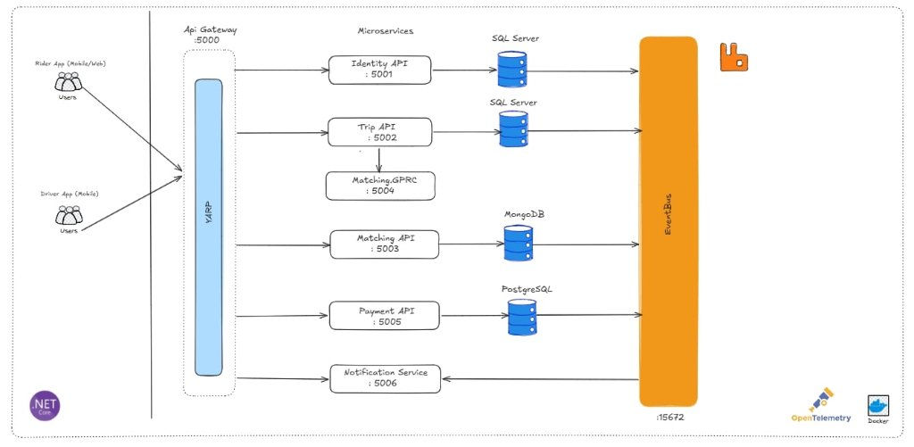
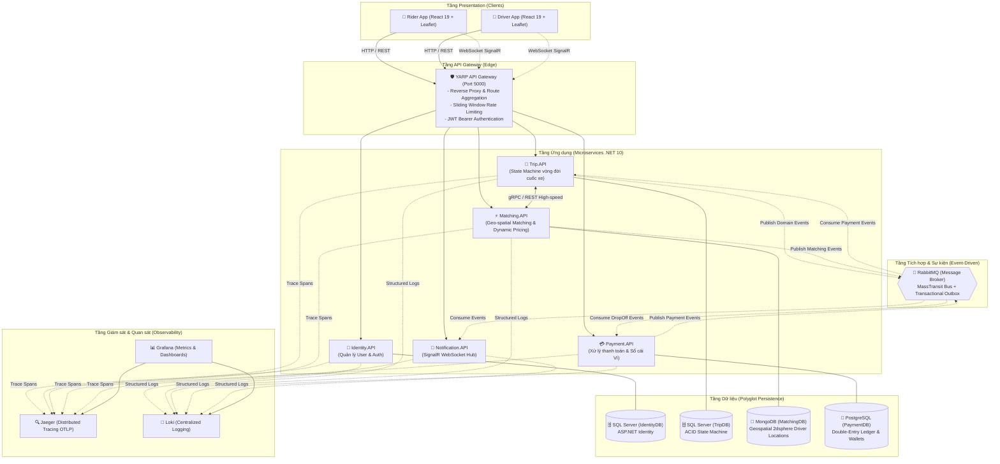
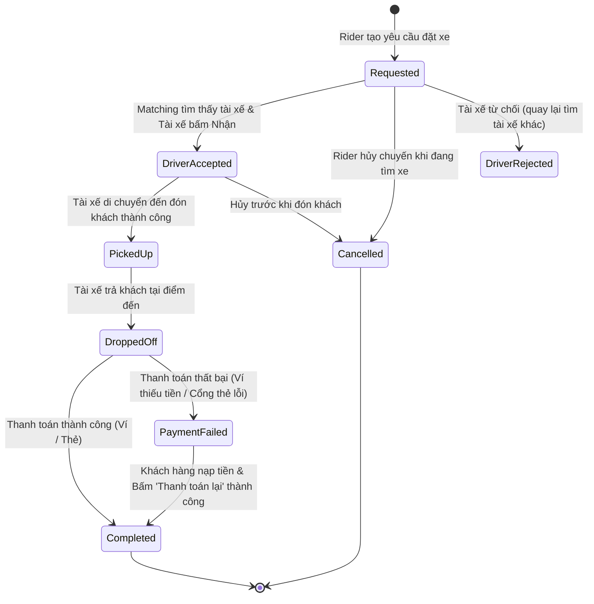
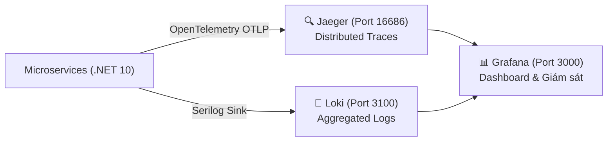

# 🚗 SwiftRide - Microservices Ride-Hailing Platform

> **Đồ án môn học:** Kiến trúc Phần mềm (Software Architecture)  
> **Đơn vị:** Khoa Công nghệ Thông tin – Trường Đại học Sài Gòn (SGU)  
> **Năm học:** 2026 – 2027  
> **Công nghệ nền tảng:** .NET 10 (C# 14), React 19, TypeScript, YARP, RabbitMQ, Docker, OpenTelemetry, Polyglot Persistence (SQL Server, PostgreSQL, MongoDB)

---

## 📌 Mục lục

- [1. Giới thiệu tổng quan](#1-giới-thiệu-tổng-quan)
- [2. Kiến trúc Hệ thống (System Architecture)](#2-kiến-trúc-hệ-thống-system-architecture)
  - [2.1 Sơ đồ kiến trúc logic & luồng dữ liệu](#21-sơ-đồ-kiến-trúc-logic--luồng-dữ-liệu)
  - [2.2 Polyglot Persistence (Đa cơ sở dữ liệu)](#22-polyglot-persistence-đa-cơ-sở-dữ-liệu)
  - [2.3 API Gateway (YARP Reverse Proxy)](#23-api-gateway-yarp-reverse-proxy)
  - [2.4 Giao tiếp Bất đồng bộ (Event-Driven & Outbox)](#24-giao-tiếp-bất-đồng-bộ-event-driven--outbox)
- [3. Vòng đời Chuyến đi & Công thức Tính giá](#3-vòng-đời-chuyến-đi--công-thức-tính-giá)
  - [3.1 Máy trạng thái (Trip State Machine)](#31-máy-trạng-thái-trip-state-machine)
  - [3.2 Công thức tính cước linh hoạt (Dynamic Pricing Formula)](#32-công-thức-tính-cước-linh-hoạt-dynamic-pricing-formula)
- [4. Áp dụng Nguyên tắc SOLID trong .NET 10](#4-áp-dụng-nguyên-tắc-solid-trong-net-10)
- [5. Các Design Patterns áp dụng](#5-các-design-patterns-áp-dụng)
- [6. Danh mục Dịch vụ & Cấu hình Cổng (Ports)](#6-danh-mục-dịch-vụ--cấu-hình-cổng-ports)
- [7. Danh mục API Endpoints tiêu biểu](#7-danh-mục-api-endpoints-tiêu-biểu)
- [8. Khả năng quan sát (Observability - Jaeger, Loki, Grafana)](#8-khả-năng-quan-sát-observability---jaeger-loki-grafana)
- [9. Cấu trúc thư mục dự án](#9-cấu-trúc-thư-mục-dự-án)
- [10. Hướng dẫn Cài đặt & Khởi chạy](#10-hướng-dẫn-cài-đặt--khởi-chạy)
  - [10.1 Yêu cầu môi trường](#101-yêu-cầu-môi-trường)
  - [10.2 Khởi chạy bằng Docker Compose](#102-khởi-chạy-bằng-docker-compose)
  - [10.3 Khởi chạy thủ công / PowerShell Script (Hybrid Mode)](#103-khởi-chạy-thủ-công--powershell-script-hybrid-mode)
  - [10.4 Khởi chạy Ứng dụng Giao diện (Frontend React)](#104-khởi-chạy-ứng-dụng-giao-diện-frontend-react)
  - [10.5 Chạy Kiểm thử (Unit & Integration Tests)](#105-chạy-kiểm-thử-unit--integration-tests)

---

## 1. Giới thiệu tổng quan

**SwiftRide** là một nền tảng đặt xe công nghệ (Ride-Hailing) mô phỏng sàn giao dịch hai phía (*two-sided marketplace*) kết nối giữa **Hành khách (Rider)** và **Tài xế (Driver)**. 

Mục tiêu cốt lõi của hệ thống là giải quyết bài toán cân bằng cung – cầu theo không gian và thời gian với độ tin cậy cao:
- **Rider**: Đặt chuyến, nhận báo giá tức thời với lộ trình trực quan, ghép tài xế gần nhất, theo dõi vị trí đón/trả và thanh toán linh hoạt (Ví điện tử hoặc Thẻ).
- **Driver**: Nhận cuốc xe phù hợp theo thuật toán định vị không gian, cập nhật trạng thái đón/trả khách, nhận doanh thu vào ví.

Dự án được xây dựng dựa trên nguyên lý kiến trúc **Microservices chuẩn doanh nghiệp**, phân rã theo Domain-Driven Design (DDD), tuân thủ nghiêm ngặt các nguyên tắc **SOLID**, ứng dụng các mẫu thiết kế **GoF / Enterprise Patterns**, đồng thời hiện thực cơ chế **Polyglot Persistence**, **Event-Driven Architecture (Saga Choreography)** và **Transactional Outbox**.

---

## 2. Kiến trúc Hệ thống (System Architecture)

### 2.1 Sơ đồ kiến trúc logic & luồng dữ liệu





---

### 2.2 Polyglot Persistence (Đa cơ sở dữ liệu)

Mỗi dịch vụ sở hữu cơ sở dữ liệu riêng biệt (**Database-per-Service**), lựa chọn hệ quản trị CSDL tối ưu nhất cho nghiệp vụ:

| Dịch vụ | Cơ sở dữ liệu | Cổng Docker | Lý do lựa chọn kiến trúc |
| :--- | :--- | :--- | :--- |
| **Trip Service** | **Microsoft SQL Server 2022** | `1435:1433` | Quản lý vòng đời cuốc xe yêu cầu bảo đảm chuẩn **ACID**, ràng buộc toàn vẹn khóa ngoại và chuyển đổi trạng thái nghiêm ngặt. |
| **Identity Service** | **Microsoft SQL Server 2022** | `1436:1433` | Tương thích chuẩn và tối ưu hóa cho ASP.NET Core Identity và Entity Framework Core. |
| **Matching & Pricing** | **MongoDB 7.x** | `27017:27017` | Dữ liệu định vị GPS của tài xế thay đổi liên tục; cần khả năng đánh chỉ mục không gian (**2dsphere Geo-spatial Index**) để truy vấn `$nearSphere` trong bán kính km cực nhanh. |
| **Payment Service** | **PostgreSQL 16** | `5433:5432` | Quản lý số dư ví, tài khoản thanh toán và sổ cái kế toán kép (**Double-Entry Ledger**) yêu cầu transaction mạnh mẽ, hỗ trợ audit log và an toàn tài chính. |

---

### 2.3 API Gateway (YARP Reverse Proxy)

Cổng vào duy nhất của hệ thống được xây dựng bằng **YARP (Yet Another Reverse Proxy)** của Microsoft chạy tại port `5000`:
- **Định tuyến thông minh (Routing)**: Tự động forward request đến đúng cụm microservice (`/api/v1/trips/*`, `/api/v1/matching/*`, `/api/v1/payments/*`, `/api/v1/auth/*`, `/hubs/notification/*`).
- **Phân quyền tập trung (Authorization)**: Áp dụng `authenticated` policy qua JWT Bearer token tại gateway cho các route nhạy cảm như thanh toán.
- **Bảo vệ hệ thống (Rate Limiting)**: Áp dụng chính sách `Sliding Window Rate Limiter` ngăn chặn tấn công từ chối dịch vụ (DDoS) và lạm dụng tài nguyên.
- **Hỗ trợ WebSocket / SignalR**: Định tuyến thông suốt các kết nối thời gian thực cho `NotificationHub`.

---

### 2.4 Giao tiếp Bất đồng bộ (Event-Driven & Outbox)

Hệ thống điều phối quy trình nghiệp vụ phức tạp giữa các dịch vụ thông qua **Choreography Saga** trên nền tảng **MassTransit** và **RabbitMQ**:
- **Transactional Outbox Pattern**: Khi cuốc xe hoàn thành hoặc thay đổi, thay đổi dữ liệu và domain event được ghi đồng thời vào DB trong cùng một database transaction. Tiến trình Outbox Publisher nền sẽ đẩy message sang RabbitMQ, cam kết thông điệp không bị thất thoát ngay cả khi network hoặc broker gặp sự cố tạm thời (**At-Least-Once Delivery**).
- **Idempotency Consumer**: Tất cả các consumer xử lý thanh toán và cuốc xe đều kiểm tra khóa `IdempotencyKey`, ngăn chặn trừ tiền hoặc cập nhật trùng lặp.
- **Hỗ trợ Đa giao dịch cho 1 Chuyến đi**: Cho phép 1 chuyến đi phát sinh nhiều giao dịch thanh toán (`PaymentTransactions`). Khi khách hàng thanh toán lại cuốc lỗi, hệ thống sinh giao dịch mới hoàn toàn mà không ghi đè lịch sử cũ.

---

## 3. Vòng đời Chuyến đi & Công thức Tính giá

### 3.1 Máy trạng thái (Trip State Machine)

Vòng đời chuyến đi được quản lý bởi **State Pattern** trong `Trip Service` tuân thủ các bước chuyển hợp lệ:



---

### 3.2 Công thức tính cước linh hoạt (Dynamic Pricing Formula)

Cước phí chuyến đi được tính toán động bởi `Matching & Pricing Service` dựa trên khoảng cách, thời gian và các yếu tố môi trường thực tế:

$$\text{Fare} = \left[ \text{BaseFare} + (d \times \text{Rate}_{\text{dist}}) + (t \times \text{Rate}_{\text{time}}) \right] \times s + c_m - \text{Promo} + \text{Tax}$$

Trong đó:
- $\text{BaseFare}$: Cước phí mở cửa tối thiểu.
- $d$: Khoảng cách di chuyển tính theo km (tính bằng tọa độ GPS Haversine hoặc định tuyến OSRM).
- $t$: Thời gian ước lượng tính theo phút.
- $s$: Hệ số giá động (**Surge Multiplier**) – tự động tăng khi trời mưa hoặc khu vực có nhu cầu cao.
- $c_m$: Phí phụ thu đặc biệt (phí cầu đường, trạm thu phí Toll).
- $\text{Promo}$: Giá trị chiết khấu từ mã giảm giá voucher.
- $\text{Tax}$: Thuế VAT theo quy định.

---

## 4. Áp dụng Nguyên tắc SOLID trong .NET 10

Dự án áp dụng triệt để 5 nguyên tắc SOLID xuyên suốt các tầng kiến trúc:

### 1. S – Single Responsibility Principle (Đơn trách nhiệm)
- Mỗi class chỉ đảm nhận đúng một nhiệm vụ duy nhất.
- Ví dụ: `CreateTripHandler` chỉ điều phối việc tạo cuốc xe; việc tính giá giao cho `PricingCalculator`; việc lưu trữ CSDL giao cho `ITripRepository`.

### 2. O – Open/Closed Principle (Đóng để sửa đổi, Mở để mở rộng)
- Dễ dàng mở rộng thêm chiến lược tính giá hoặc phương thức thanh toán mới mà không can thiệp code cũ.
- Ví dụ: Hệ thống định nghĩa `IPricingStrategy`. Khi bổ sung `SurgePricingStrategy`, `RainPricingStrategy` hay `TollPricingStrategy`, ta chỉ cần tạo class mới hiện thực interface mà không sửa đổi `StandardPricingStrategy`.

### 3. L – Liskov Substitution Principle (Thay thế Liskov)
- Mọi implementation của `IPaymentStrategy` (`WalletPaymentStrategy`, `CardPaymentStrategy`) đều có thể thay thế cho nhau hoàn hảo trong `CreatePaymentCommandHandler`, luôn bảo đảm trả về `Result<PaymentOutcome>` chuẩn mực mà không gây crash hệ thống.

### 4. I – Interface Segregation Principle (Phân tách Interface)
- Thay vì tạo một interface "béo" cồng kềnh, hệ thống chia nhỏ thành các interface tinh gọn: `ITripRepository` (quản lý entity), `IPaymentRepository` (quản lý transaction), `IWalletRepository` (quản lý số dư).

### 5. D – Dependency Inversion Principle (Đảo ngược Phụ thuộc)
- Các tầng nghiệp vụ cấp cao (Domain & Application) hoàn toàn độc lập với chi tiết kỹ thuật ở tầng Infrastructure.
- Toàn bộ dependency (DbContext, Repositories, Message Publisher, SignalR Context) đều được tiêm thông qua Abstraction/Interface bằng Built-in Dependency Injection container của .NET.

---

## 5. Các Design Patterns áp dụng

| Nhóm Pattern | Pattern | Ứng dụng cụ thể trong SwiftRide |
| :--- | :--- | :--- |
| **Behavioral** | **State Pattern** | Quản lý máy trạng thái chuyến đi (`TripState`, `RequestedState`, `AcceptedState`, `DroppedOffState`...) đảm bảo các transition hợp lệ. |
| **Behavioral** | **Strategy Pattern** | Đóng gói thuật toán tính cước (`IPricingStrategy`: Standard, Surge, Rainy, Toll, Promo) và xử lý thanh toán (`IPaymentStrategy`: Wallet, Card). |
| **Behavioral** | **Observer / Pub-Sub** | Phát và lắng nghe Domain Events qua MassTransit & RabbitMQ (`TripCreatedEvent`, `TripDropOffEvent`, `PaymentCompletedEvent`...). |
| **Creational** | **Factory Pattern** | `PaymentStrategyFactory` tạo đúng đối tượng xử lý thanh toán theo `PaymentMethod` được chỉ định tại runtime. |
| **Architectural** | **API Gateway Pattern** | Đóng gói toàn bộ backend microservices sau gateway YARP, cung cấp điểm truy cập thống nhất. |
| **Architectural** | **Transactional Outbox** | Đảm bảo lưu dữ liệu CSDL và gửi event ra RabbitMQ diễn ra nguyên tử (atomic), chống mất mát dữ liệu. |
| **Architectural** | **Choreography Saga** | Điều phối luồng đặt xe - nhận cuốc - di chuyển - thanh toán giữa các microservices độc lập thông qua message events. |
| **Domain** | **Repository Pattern** | Đóng gói logic truy vấn dữ liệu Entity Framework Core và MongoDB, cung cấp interface sạch cho Application. |

---

## 6. Danh mục Dịch vụ & Cấu hình Cổng (Ports)

| Dịch vụ | Công nghệ | Cổng Local (Dev) | Cổng Docker Compose | Mục đích |
| :--- | :--- | :--- | :--- | :--- |
| **YARP API Gateway** | ASP.NET Core YARP | `5000` | `5000` / `6000` | Reverse Proxy, Rate Limit, Auth Routing |
| **Identity.API** | ASP.NET Identity, JWT | `5001` | `6001` | Đăng ký, đăng nhập, quản lý user Rider/Driver |
| **Trip.API** | ASP.NET Core Minimal API | `5002` | `6002` | Quản lý vòng đời cuốc xe (State Machine) |
| **Matching.API** | MongoDB Driver, gRPC/REST | `5003` (HTTP) / `5004` (gRPC) | `6003` / `6004` | Ghép tài xế không gian & tính cước động |
| **Payment.API** | Npgsql, EF Core | `5005` | `6005` | Xử lý thanh toán ví, cổng thẻ & sổ cái |
| **Notification.API** | ASP.NET Core SignalR | `5006` | `6006` | Đẩy thông báo thời gian thực qua WebSocket |
| **TripDB** | Microsoft SQL Server 2022 | `1435` | `1435:1433` | CSDL lưu trữ cuốc xe |
| **IdentityDB** | Microsoft SQL Server 2022 | `1436` | `1436:1433` | CSDL tài khoản & phân quyền |
| **PaymentDB** | PostgreSQL 16 | `5433` | `5433:5432` | CSDL thanh toán & sổ cái ví |
| **MatchingDB** | MongoDB 7.x | `27017` | `27017:27017` | CSDL vị trí tài xế (GeoJSON 2dsphere) |
| **RabbitMQ** | RabbitMQ 3-Management | `5672` (AMQP) / `15672` (UI) | `5672` / `15672` | Message Broker & Management Web UI |
| **Jaeger** | Jaeger All-In-One | `16686` (UI) / `4317` (OTLP) | `16686` / `4317` | Thu thập & hiển thị Distributed Tracing |
| **Loki** | Grafana Loki | `3100` | `3100` | Thu thập tập trung Structured Logs |
| **Grafana** | Grafana Dashboard | `3000` | `3000` | Giám sát trực quan Metrics, Logs & Traces |

---

## 7. Danh mục API Endpoints tiêu biểu

Tất cả các API bên dưới đều được gọi qua **API Gateway** tại địa chỉ: `http://localhost:5000`

### 7.1 Xác thực & Người dùng (Identity Service)
- `POST /api/v1/auth/register`: Đăng ký tài khoản mới (Rider hoặc Driver).
- `POST /api/v1/auth/login`: Đăng nhập, nhận JWT Token.
- `GET /api/v1/users/riders`: Lấy danh sách tài khoản khách hàng.
- `GET /api/v1/users/drivers`: Lấy danh sách tài khoản tài xế.

### 7.2 Quản lý Chuyến đi (Trip Service)
- `POST /api/v1/trips`: Đặt cuốc xe mới (tính toán cước dự kiến và tạo trạng thái `Requested`).
- `GET /api/v1/trips/{id}`: Xem chi tiết cuốc xe theo ID.
- `GET /api/v1/trips/rider/{riderId}`: Lấy lịch sử tất cả chuyến đi của một khách hàng.
- `POST /api/v1/trips/{id}/driver-accept`: Tài xế chấp nhận cuốc xe.
- `POST /api/v1/trips/{id}/driver-reject`: Tài xế từ chối cuốc xe (kèm lý do).
- `POST /api/v1/trips/{id}/pickup`: Tài xế xác nhận đã đón khách.
- `POST /api/v1/trips/{id}/dropoff`: Tài xế xác nhận đã trả khách (kích hoạt thanh toán tự động).
- `POST /api/v1/trips/{id}/cancel`: Hủy cuốc xe khi đang ở trạng thái tìm tài xế.

### 7.3 Ghép tài xế & Báo giá (Matching & Pricing Service)
- `POST /api/v1/matching/match`: Tìm kiếm tài xế gần tọa độ đón nhất theo thuật toán Geo-spatial.
- `POST /api/v1/matching/quote`: Tính cước chi tiết (khoảng cách, thời gian, phụ phí mưa, trạm thu phí, voucher giảm giá).
- `GET /api/v1/matching/drivers/locations`: Lấy tọa độ GPS thời gian thực của các tài xế trực tuyến trên bản đồ.

### 7.4 Thanh toán & Ví tiền (Payment Service)
- `POST /api/v1/payments`: Tạo giao dịch thanh toán mới cho cuốc xe (hỗ trợ thanh toán lại cuốc lỗi).
- `GET /api/v1/payments/wallets/{userId}`: Lấy thông tin số dư ví điện tử của người dùng.
- `POST /api/v1/payments/wallets/{userId}/topup`: Nạp tiền trực tiếp vào ví SwiftRide.
- `GET /api/v1/payments/wallets/{userId}/ledger`: Xem lịch sử biến động số dư / sổ cái giao dịch.

### 7.5 Kết nối thời gian thực (Notification Service)
- `WS /hubs/notification`: Kết nối WebSocket SignalR nhận thông báo realtime (Trạng thái chuyến, Tài xế nhận cuốc, Bị từ chối, v.v.).

---

## 8. Khả năng quan sát (Observability - Jaeger, Loki, Grafana)

Hệ thống tích hợp giải pháp quan sát toàn diện theo tiêu chuẩn OpenTelemetry:



- **Distributed Tracing (Jaeger)**: Mỗi request từ Client khi đi qua YARP Gateway sẽ được gán `traceparent` context. Khi request đi xuyên qua các service (Trip -> Matching -> RabbitMQ -> Payment), toàn bộ vết thực thi được ghi nhận và hiển thị dưới dạng biểu đồ thác nước tại `http://localhost:16686`.
- **Centralized Logging (Loki)**: Cấu hình `Serilog` đẩy log có cấu trúc (JSON Structured Logs) gắn kèm `TraceId` và `SpanId` về Loki tại `http://localhost:3100`.
- **Giám sát trực quan (Grafana)**: Truy cập `http://localhost:3000` (User: `admin` / Password: `admin`) để phân tích hiệu năng, theo dõi lỗi thanh toán, độ trễ API và trạng thái hàng đợi.

---

## 9. Cấu trúc thư mục dự án

```text
SwiftRide-Microservice/
├── .github/                      # CI/CD Workflows
├── docker/                       # Cấu hình Grafana Provisioning & Datasources
│   └── grafana/
├── src/
│   ├── ApiGateways/
│   │   └── YARPAPiGw/            # YARP API Gateway (Reverse Proxy, Rate Limit, Auth)
│   ├── BuildingBlocks/           # Các thư viện dùng chung cho toàn bộ Microservices
│   │   ├── Common.Logging/       # Cấu hình Serilog & OpenTelemetry
│   │   ├── Contracts/            # Domain Abstractions, Interfaces chuẩn
│   │   ├── EventBus.Messages/    # Định nghĩa Message Events (MassTransit)
│   │   ├── Infrastructure/       # Base Repositories, Outbox Helpers
│   │   └── Shared/               # CQRS Result pattern, Enums, DTOs
│   ├── Services/
│   │   ├── Identity/             # Dịch vụ Quản lý User & Xác thực (SQL Server)
│   │   ├── Matching/             # Dịch vụ Ghép tài xế & Tính cước (MongoDB)
│   │   ├── Notification/         # Dịch vụ Thông báo Realtime qua SignalR Hub
│   │   ├── Payment/              # Dịch vụ Thanh toán & Sổ cái Ví (PostgreSQL)
│   │   └── Trip/                 # Dịch vụ Vòng đời Chuyến đi (SQL Server)
│   └── tests/                    # Dự án Kiểm thử
│       ├── Matching/             # Unit & Integration Tests cho Matching
│       ├── Payment/              # Unit & Integration Tests cho Payment
│       └── Trip/                 # Unit & Integration Tests cho Trip
├── docker-compose.yml            # Docker Compose định nghĩa CSDL, Broker, Tooling
├── docker-compose.override.yml   # Cấu hình ánh xạ cổng, biến môi trường container
├── run-backend-services.ps1      # Script PowerShell chạy đồng thời 6 microservices
├── start-services.ps1            # Script PowerShell khởi chạy nền các services
├── stop-services.ps1             # Script dừng toàn bộ tiến trình .NET
└── README.md                     # Tài liệu hướng dẫn dự án
```

---

## 10. Hướng dẫn Cài đặt & Khởi chạy

### 10.1 Yêu cầu môi trường
- **.NET 10 SDK** (hoặc mới nhất).
- **Docker Desktop** (hỗ trợ Docker Compose).
- **Node.js 20+ & npm** (để chạy Frontend React).
- **PowerShell 7+** (trên Windows).

---

### 10.2 Khởi chạy bằng Docker Compose

Để chạy toàn bộ hệ thống (4 Cơ sở dữ liệu, RabbitMQ, Jaeger, Loki, Grafana và 6 Microservices) trong môi trường Docker container:

```bash
# 1. Di chuyển vào thư mục dự án
cd e:\KTPM\SwiftRide-Microservice

# 2. Xây dựng và khởi chạy tất cả containers
docker compose up -d --build
```

Kiểm tra trạng thái các containers:
```bash
docker compose ps
```

---

### 10.3 Khởi chạy thủ công / PowerShell Script (Hybrid Mode)

Chế độ khuyên dùng khi phát triển (**Development Mode**): Chạy CSDL và Broker trong Docker, chạy trực tiếp mã nguồn .NET trên máy host để dễ dàng debug và xem console log:

```powershell
# Bước 1: Khởi động các dịch vụ Hạ tầng (Databases, RabbitMQ, Observability)
docker compose up -d tripdb identitydb paymentdb matchingdb rabbitmq jaeger loki grafana

# Bước 2: Cập nhật Migration CSDL (nếu chạy lần đầu)
dotnet ef database update --project src/Services/Trip/Trip.Infrastructure --startup-project src/Services/Trip/Trip.API
dotnet ef database update --project src/Services/Payment/Payment.Infrastructure --startup-project src/Services/Payment/Payment.API

# Bước 3: Khởi chạy đồng thời toàn bộ 6 Microservices bằng script tiện ích
./run-backend-services.ps1
```

> **Mẹo**: Để dừng tất cả các service đang chạy ngầm, thực thi script:
> ```powershell
> ./stop-services.ps1
> ```

---

### 10.4 Khởi chạy Ứng dụng Giao diện (Frontend React)

Dự án Frontend được đặt tại thư mục `e:\KTPM\FE_SwiftRide`:

```bash
# 1. Di chuyển sang thư mục Frontend
cd e:\KTPM\FE_SwiftRide

# 2. Cài đặt các thư viện phụ thuộc
npm install

# 3. Khởi chạy máy chủ phát triển Vite
npm run dev
```

Truy cập ứng dụng trên trình duyệt:
- Ứng dụng Hành khách (Rider App): `http://localhost:5173/rider`
- Ứng dụng Tài xế (Driver App): `http://localhost:5173/driver`
- Giao diện kết nối trực tiếp với backend qua API Gateway tại: `http://localhost:5000`

---

### 10.5 Chạy Kiểm thử (Unit & Integration Tests)

Hệ thống xây dựng bộ kiểm thử tự động sử dụng **xUnit v3**, **Moq**, và **Testcontainers** (tự động khởi tạo PostgreSQL/SQL Server thật để kiểm thử tích hợp chuẩn AAA - Arrange, Act, Assert):

```bash
# Chạy toàn bộ các bài test trong solution
dotnet test

# Chạy riêng Unit Tests của Payment Service
dotnet test src/tests/Payment/Payment.UnitTests

# Chạy riêng Integration Tests của Trip Service
dotnet test src/tests/Trip/Trip.IntegrationTests
```

---

## 👥 Đội ngũ thực hiện

- **Đơn vị:** Khoa Công nghệ Thông tin – Trường Đại học Sài Gòn (SGU)
- **Học phần:** Kiến trúc Phần mềm
- **Giảng viên hướng dẫn:** Bộ môn Công nghệ Phần mềm

---
*Chúc bạn có trải nghiệm tuyệt vời khi trải nghiệm và phát triển nền tảng SwiftRide!*
